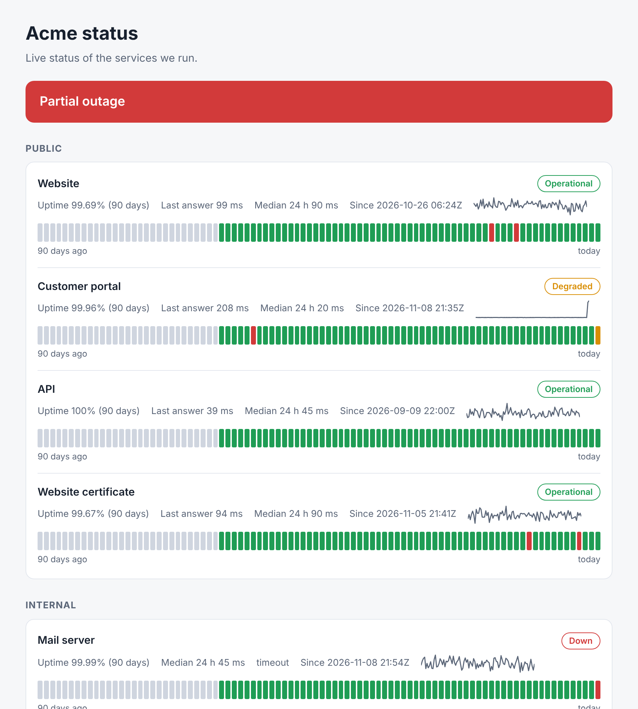

# upstatus: service checks and a static status page

[](https://github.com/TexAlphaWolf/net-status-page/actions/workflows/ci.yml)
[](https://github.com/TexAlphaWolf/net-status-page/actions/workflows/codeql.yml)

Checks your services over **HTTP, TCP, DNS, TLS (certificate expiry) and ping**, keeps the history in one SQLite file,
and publishes a **static status page**: one HTML file with no script, 90 days of daily status, uptime, response time,
and the incidents. It can call a webhook when something goes down or comes back. Python standard library only, no dependencies.



*The screenshot is made from simulated services (`tools/screenshot.py`): one is down and one is slow right now.*

## Why not just alert on a failed check?

Because a single failed check is almost never an outage. On a simulated month (60 services, one check a minute,
0.5% of the checks failing at random) the rule "one failed check = outage" raised **13,369** outage alerts for **200**
real outages. upstatus calls a service down after 3 failed checks in a row and up after 2 good ones: it found
**200 of 200** real outages, raised 202 alerts, none of them for an outage that did not exist, and its downtime figure was 3% below the truth
(the blips shorter than 3 checks are left out on purpose) while the failed checks counted one by one overstated it by 66%. The price is the delay: the alert comes at
the third failed check, and the outage is dated from the **first** one.

## Quick start

```bash
git clone https://github.com/TexAlphaWolf/net-status-page && cd net-status-page
pip install .
upstatus init                    # writes upstatus.toml: edit the checks
upstatus watch                   # runs the checks when they are due; writes public/index.html
```

Look at the page with `upstatus serve` (local only), or put the `public/` folder behind any web server, or on GitHub
Pages. With Docker (the history and the page are in the volume):

```bash
docker build -t upstatus .
docker run --rm -v upstatus-data:/data upstatus init
docker run -d --name upstatus -v upstatus-data:/data upstatus watch
docker run --rm -v upstatus-data:/data upstatus status
```

## Configuration

```toml
[site]
title = "Homelab status"
output = "public"            # index.html and status.json are written here
data = "upstatus-data"       # the history

[defaults]
interval = "1m"
timeout = 5
fail_after = 3               # failed checks in a row before a service is called down
recover_after = 2            # good checks in a row before it is called up again

[notify]                     # optional; the URL is the value of an environment variable, never written in the file
webhook_env = "UPSTATUS_WEBHOOK"
on = ["down", "up"]

[[check]]
name = "Website"
group = "Public"
type = "http"
url = "https://example.org/"
expect_status = [200]
contains = "Example Domain"

[[check]]
name = "Router"
type = "ping"
host = "192.168.1.1"
```

| type | what is checked | extra keys |
|---|---|---|
| `http` | the status code, optionally a text in the first 64 KiB of the page | `url`, `expect_status`, `contains`, `ca_file` |
| `tcp` | a connection can be opened | `host`, `port` |
| `dns` | the name resolves, optionally to a given address | `host`, `expect` |
| `tls` | the handshake works and the certificate is valid for at least `min_days` more days | `host`, `port`, `min_days`, `ca_file` |
| `ping` | the system `ping` gets an answer | `host` |

A full example is in [examples/](examples/). Paths in the file are relative to the file.

## Commands

| command | what it does |
|---|---|
| `init` | write an example configuration |
| `validate` | read the configuration and report any mistake |
| `run` | run the checks that are due and update the page; exit 1 if something is down |
| `watch` | keep running the checks and keep the page up to date |
| `build` | write the page from the stored history, without running any check |
| `status` | one line per check; exit 1 if one is down |
| `incidents` | list outages and slow periods (`--since 7d`) |
| `serve` | serve the page on a local port, to have a look |

`--config FILE` (default `upstatus.toml`) comes before the command. Exit codes: 0 fine, 1 something is down, 2 a mistake in the
command line or the configuration.

## How it decides

- **Down.** `fail_after` failed checks in a row. The outage starts at the first failed check and ends at the first
  good check of the recovery, so a short outage is dated right, not three minutes late.
- **Up again.** `recover_after` good checks in a row. A failure in the middle starts the count again.
- **Slow (degraded).** A service that answers, but 3 times slower than its usual time **and** 100 ms more, 5 checks in
  a row. "Usual" is the median of the last 60 normal answers. A lasting change becomes the new usual time after
  180 slow checks in a row. A fast service that gets slower but is still fast is left alone.
- **Uptime** is the time not spent in a confirmed outage, per day and over 90 days; slow periods are shown in yellow and
  are not downtime.

Details in [docs/architecture.md](docs/architecture.md).

## Measured results

From `docs/report.json`, a full run (the method and every table in [docs/evaluation.md](docs/evaluation.md); the simulator
is not the internet, see [docs/limitations.md](docs/limitations.md)).

- Real servers on loopback: the check adds about 1 ms to the time of the server; all 6 kinds of failure are named right
  (refused, timeout, HTTP 503, text not found, name not found); a real outage cycle gives one incident with an exact start and end.
- Simulated month: outages found **200 of 200**, 0 outages that did not exist, a median of 2 checks to alert; slow periods found **65 of 65**, 0 invented.
- Cost: 50 checks with 7 days each (504,000 results) are written in 1.5 s; the page takes 0.075 s; about 31 MiB per check and year at one check a minute.

## Security and data

- Checks run in your process with an argument list for `ping`, never a shell. Hosts are IP addresses or host names, URLs are
  http(s) without credentials. The webhook URL, which is a secret, is read from an environment variable and the configuration
  file refuses to hold it. HTTPS is verified (`ca_file` for a private CA). See [SECURITY.md](SECURITY.md).
- **The page shows names, never addresses**: it is meant to be public, so the hosts, ports and paths of your checks are not in
  `index.html` or `status.json`. Still, the *names* you choose and the fact that a service is down are public.
- The page has no script and no external file (`default-src 'none'`).

## Development

```bash
pip install -e ".[dev]"
ruff check . && ruff format --check . && mypy && pytest -n auto --cov
python tools/evaluate.py --quick        # a few seconds; without --quick the full evaluation
```

Python 3.11 to 3.14. See [CONTRIBUTING.md](CONTRIBUTING.md). Part of a portfolio of network and security projects.

## License

MIT - Luca Tessitore
