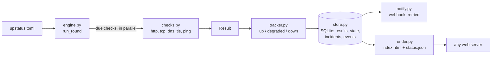

# Architecture

| module | job |
|---|---|
| `config.py` | the TOML file, every value validated; unknown keys are errors (a typo is not silently ignored) |
| `checks.py` | one function per kind of check; they never raise and they never put text from the network into a result, only fixed phrases |
| `tracker.py` | the decision, pure and deterministic: results in, state and events out |
| `store.py` | one SQLite file: results (pruned after `retention_days`), the state of every check, incidents, events waiting to be sent |
| `engine.py` | one round: which checks are due, run them in parallel, let the tracker decide, store, notify, prune |
| `notify.py` | webhook delivery; an event stays in the store until it has been delivered, in order |
| `render.py` | the page and `status.json`, written atomically |
| `cli.py` | the commands and the exit codes |

## The decision

State per check: `unknown`, `up`, `degraded`, `down`. It is stored after every result, so every run of `upstatus run`
(from cron, say) continues where the previous one stopped, and a restart loses nothing.

1. A failed check adds to a count; at `fail_after` the state is `down` and an event is made. Its `since` is the time of
   the **first** failed check.
2. A good check in `down` adds to another count; at `recover_after` the state is `up`. `since` is the first good check.
3. Latency (only when up): the usual time is the median of the last 60 normal answers (at least 20 are needed). An answer
   is slow if it exceeds `max(usual * slow_factor, usual + slow_ms)`. `slow_after` slow answers in a row make the state
   `degraded`; as many normal ones end it. Slow answers never move the usual time, except after 180 in a row, when the
   new time is accepted as normal.
4. Events are paired into incidents by a pure function that the store applies identically, so the history can be rebuilt.

Uptime per day = 1 - (time in a `down` incident that day) / (time observed that day). Observation starts at the first result.
